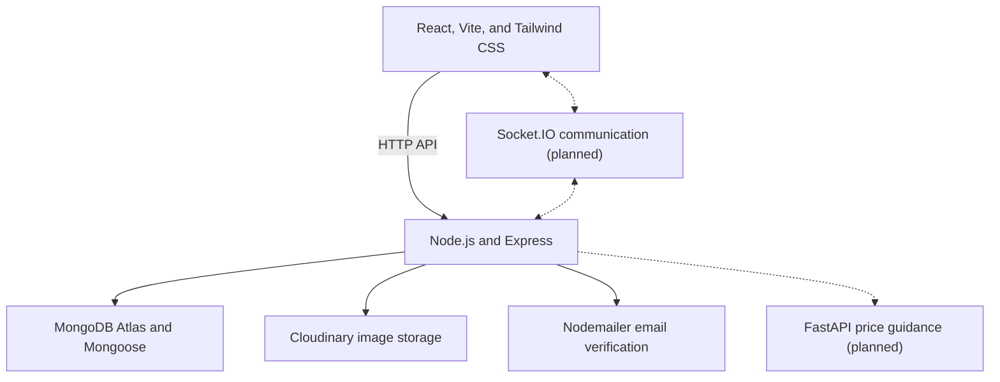

# Campus Exchange

**Smart Campus Resource Exchange & Reuse Platform**

Campus Exchange is a campus marketplace where students can buy, sell, exchange, or donate items within their university community. It makes academic materials, hostel essentials, and placement resources easier to find and more affordable while encouraging students to reuse items.

The platform focuses on a trusted campus community. Students can list items, search for what they need, post requests, connect with other students, and use price guidance to make more informed buying and selling decisions.

## Contents

- [Key Features](#key-features)
- [Technology Stack](#technology-stack)
- [System Architecture](#system-architecture)
- [Getting Started](#getting-started)
- [Environment Variables](#environment-variables)
- [Suggested Project Structure](#suggested-project-structure)
- [Development Roadmap](#development-roadmap)
- [Security and Privacy](#security-and-privacy)
- [Sustainability and Impact](#sustainability-and-impact)
- [Future Enhancements](#future-enhancements)
- [Team](#team)
- [Contribution](#contribution)
- [License](#license)

## Key Features

### 1. Student Authentication

- Register and log in securely.
- Authenticate users with JWT and hash passwords with bcrypt.
- Verify accounts using one-time passwords (OTPs) sent by email.

### 2. Campus Marketplace

- Create, update, and delete item listings.
- Browse listings from other students and view item details, images, condition, and asking price.
- Organize listings into categories such as books, electronics, hostel essentials, and placement resources.

### 3. Search and Discovery

- Search listings by title or keyword.
- Filter results by category, price, and condition.
- Explore relevant listings through an interface designed for students.

### 4. Wanted Posts and Smart Matching

- Publish a wanted post when an item you need is unavailable.
- Browse wanted posts and respond with suitable listings.
- Match student requests with relevant items in the marketplace.

### 5. Offers and Negotiation

- Send offers on listed items.
- Let sellers review and respond to offers so both parties can agree on a price.

### 6. Wishlist

- Save listings of interest and revisit them later.

### 7. Intelligent Price Guidance

- Suggest indicative resale prices to help students decide what to ask or offer.
- Use item details and available listing data as inputs for future machine-learning enhancements.
- Leave the final price to the buyer and seller.

### 8. Move-Out and Reuse

- Exchange or donate items students no longer need.
- Keep books, furniture, appliances, and other essentials in use.
- Help reduce waste at the end of a semester or academic year.

### 9. Admin and Resource Management

- Give administrators oversight of users and listings.
- Support moderation of inappropriate or misleading content.
- Provide a foundation for campus resource information and platform analytics.

### 10. Real-Time Communication

- Plan for live buyer–seller communication and updates using Socket.IO.
- Introduce advanced communication features incrementally once the core marketplace workflow is stable.

## Technology Stack

| Layer | Technologies |
| --- | --- |
| Frontend | React.js, Vite, Tailwind CSS |
| Backend | Node.js, Express.js |
| Database | MongoDB, MongoDB Atlas |
| Object data modeling (ODM) | Mongoose |
| Authentication | JWT, bcrypt |
| Real-time communication | Socket.IO |
| Image storage | Cloudinary |
| Email verification | Nodemailer, OTP |
| AI/ML service | Python, FastAPI, Pandas, NumPy, scikit-learn |
| API testing | Postman |
| Version control | Git, GitHub |
| Deployment | Vercel (frontend), Render (backend) |

Campus Exchange uses **MongoDB** as its database and **Mongoose** for data modeling and database operations.

## System Architecture

| Component | Responsibility |
| --- | --- |
| React frontend | Provides student and administrator interfaces. |
| Express backend API | Handles authentication, listings, wanted posts, offers, wishlists, and administrative operations. |
| MongoDB and Mongoose | Store users, listings, requests, offers, and related records. |
| Cloudinary | Stores listing images and provides image URLs for the application. |
| Nodemailer | Sends verification OTPs by email. |
| FastAPI service | Planned as a separate Python service for price guidance and other data-driven features. |
| Socket.IO | Planned for live communication and updates between users. |

## Getting Started

### Prerequisites

- Node.js (LTS recommended)
- npm
- A MongoDB Atlas account or a local MongoDB instance
- Git

## Environment Variables

Keep local credentials and configuration in `.env` files and exclude them from version control using `.gitignore`. Keep database passwords, JWT secrets, and API keys out of GitHub.

Provide a `.env.example` file with placeholder values so contributors can configure the application locally.

## Suggested Project Structure

This suggested structure may evolve as development progresses.

| Path | Contents |
| --- | --- |
| `frontend/public/` | Public frontend files |
| `frontend/src/` | `components/`, `pages/`, `services/`, `context/`, and `assets/` |
| `backend/` | `config/`, `controllers/`, `middleware/`, `models/`, `routes/`, `utils/`, and `server.js` |
| `ai-service/` | `models/`, `services/`, `main.py`, and `requirements.txt` |
| Project root | `.gitignore` and `README.md` |

## Development Roadmap

| Phase | Work |
| --- | --- |
| 1 | Requirements analysis, UI planning, and project setup |
| 2 | Authentication and user profile management |
| 3 | Marketplace listings, categories, and item details |
| 4 | Search, filters, wanted posts, and matching |
| 5 | Offers, wishlist, and price guidance |
| 6 | Admin features, testing, and deployment |
| 7 | Incremental AI/ML and real-time enhancements |

## Security and Privacy

- Store passwords as secure hashes.
- Protect private routes with JWT authentication.
- Validate and sanitize incoming data on the server.
- Store secrets and API credentials in environment variables.
- Restrict administrative actions to authorized users.
- Keep private user information out of public listing responses.

## Sustainability and Impact

Campus Exchange helps students pass on useful items when they move out or finish a semester. Reusing those items can reduce waste and unnecessary spending, improve access to affordable academic and hostel essentials, and help students connect across campus.

## Future Enhancements

- Improved recommendations and item matching
- More advanced ML-based resale price estimation
- QR-based item handover or verification
- Enhanced real-time chat and notifications
- Additional campus resource-sharing workflows
- Expanded analytics for administrators

## Team

Developed as a **B.Tech. Computer Science and Engineering final-year major project** at **GLA University, Mathura**.

| Team member | Role |
| --- | --- |
| Neha Singh | Team member |
| Pavitra Malhotra | Team member |
| Shristi | Team member |
| Vanisha Mittal | Group lead |
| Yati | Team member |

## Contribution

Contributions from team members and suggestions for improving Campus Exchange are welcome. Discuss major changes with the project team before submitting a pull request.

## License

Campus Exchange was developed for academic purposes. The team can add an open-source license if it decides to distribute the code under those terms.
